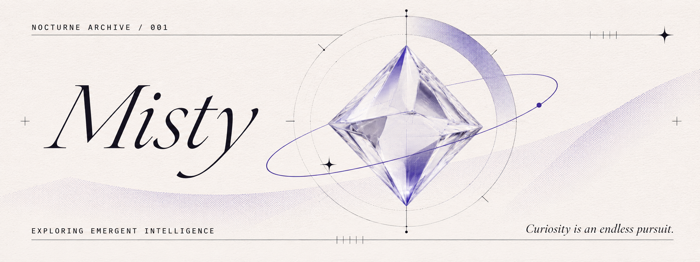
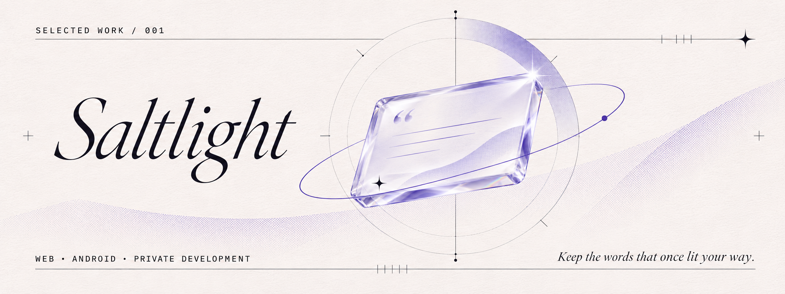
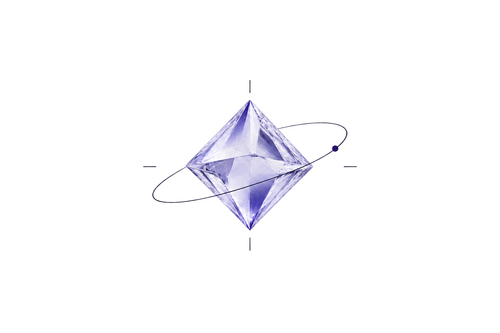

  

---

### ✦ About

I'm Misty — a developer and independent creator interested in how intelligence emerges, learns, and becomes autonomous.

I build at the intersection of artificial intelligence, software, and creative expression — turning quiet ideas into things that can be experienced.

Currently studying algorithms, intelligent systems, and the mechanisms behind learning, one careful layer at a time.

### ✦ Selected Work

  

  <i>A visual reading and composition space for collecting sentences, arranging cards, and turning fragments of thought into something worth keeping.</i>

### ✦ Current Coordinates

- `STUDYING` Algorithms, data structures, and software foundations
- `EXPLORING` Emergent intelligence and autonomous learning
- `CREATING` Quiet tools where technology meets personal expression

- ### ✦ Elsewhere

  <a href="https://afterlight-q05.pages.dev"><b>AFTERLIGHT</b></a>
   
  Essays, notes, experiments, and fragments from the archive.

---

  

  AFTERLIGHT · A maker's mark by Misty

